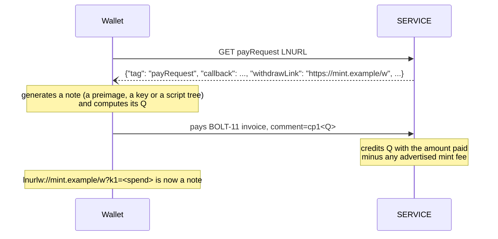
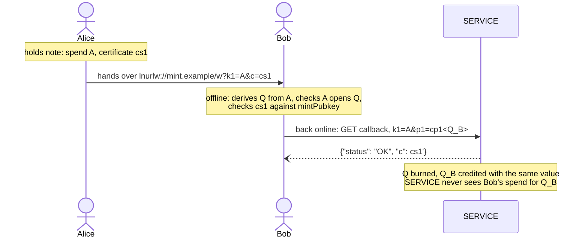

LUD-25: `LNURLcash`, Bearer assets.
====================================================

`author: dni` `co-authors: tbk (Thebora Kompanioni), thecryptodonkey` `status: draft`

---

## Motivation

LNURL-withdraw ([LUD-03](03.md)) links are redeemable by anyone who holds a valid `k1`. `LNURLcash` turns that `k1` into a bearer asset: a `k1` that a `SERVICE` has credited with value can be copied, printed, NFC-tapped or handed over like a banknote, and can be rotated, split or merged. It adds **no new endpoint**: a `WALLET` that does not know `LNURLcash` sees an ordinary withdraw link and cashes it out to a BOLT-11 invoice as usual. Minting only needs a `WALLET` able to attach a [LUD-12](12.md) comment.

Every note is a [BIP-341](https://github.com/bitcoin/bips/blob/master/bip-0341.mediawiki) taproot output key `Q`, spent by a witness Bitcoin's own script rules accept for `Q`: a hashlock for a plain bearer secret, a signature for a key-owned note, or any other tapscript condition (timelocks, multi-party leaves), which makes the note a *programmable* withdraw link. One lookup (`Q` → value), one verification rule and one certificate format cover all of them, and `SERVICE` can delegate verification to Bitcoin Core's script interpreter (`libbitcoinkernel`).

## Notes

### Output keys and spends

A note is identified by a 32-byte x-only taproot output key `Q`, written `cp1<Q>`. `WALLET` generates notes itself, without contacting `SERVICE`; `SERVICE` tracks outstanding notes as `Q` → value and never needs anything secret to do so.

A note is spent in one of the two ways a taproot output is spent on-chain:

* **Key path, `ck1<...>`.** A [BIP-340](https://github.com/bitcoin/bips/blob/master/bip-0340.mediawiki) Schnorr signature by `Q`, carried alongside `Q`.
* **Script path, `cw1<...>`.** A leaf script, its control block, and the witness items the script consumes. `SERVICE` recomputes `Q` from the control block to find the note; unused leaves stay private.

Either one is a *spend*: the bearer secret, which goes wherever [LUD-03](03.md) puts a `k1`.

`SERVICE` MUST accept every spend that [BIP-341](https://github.com/bitcoin/bips/blob/master/bip-0341.mediawiki)/[BIP-342](https://github.com/bitcoin/bips/blob/master/bip-0342.mediawiki) consensus rules accept as input 0 of the canonical spend transaction, key path or any leaf script, subject only to the timelock rules and these exceptions:

* `SERVICE` MUST reject a spend whose leaf version is not `0xc0`, or whose leaf contains any `OP_SUCCESSx` opcode outside pushed data (consensus would accept it unconditionally).
* `WALLET` MUST NOT use a public key that is neither empty nor 32 bytes in a signature check ([BIP-342](https://github.com/bitcoin/bips/blob/master/bip-0342.mediawiki)'s upgradable key types), since consensus lets any signature pass against one.

### Bearer notes

`WALLET` generates a random 32-byte `preimage`, computes `h = sha256(preimage)`, and builds

```
leaf    = OP_SHA256 <h> OP_EQUAL                      // a8 20 <h> 87
Q       = x(lift_x(H) + tagged_hash("TapTweak", H || tapleaf_hash(leaf))·G)
control = (0xc0 | parity(Q)) || H
```

where `H` is [BIP-341](https://github.com/bitcoin/bips/blob/master/bip-0341.mediawiki#constructing-and-spending-taproot-outputs)'s nothing-up-my-sleeve point `50929b74c1a04954b78b4b6035e97a5e078a5a0f28ec96d547bfee9ace803ac0` (so there is no key path) and `tapleaf_hash` uses leaf version `0xc0`. Its `cw1` is the script-path spend with witness `[preimage]`.

#### Short forms

Everything but the preimage follows from `h`, so `SERVICE` MUST accept both short forms, exactly 64 hex characters (no `cp1`, `ck1` or `cw1` has that length):

* **`k1` short form.** Wherever a spend is expected, hex is the `preimage`. `SERVICE` builds the bearer note's `cw1` from it (the leaf and control block above, witness `[preimage]`, locktime 0, sequence `0xffffffff`) and handles it exactly like that `cw1`.
* **`cp1` short form.** Wherever a `cp1` is expected (a mint `comment`, `p1`/`p2`, `?p=`), hex is `h`. `SERVICE` computes the bearer note's `Q` from it and handles it exactly like `cp1<Q>`.

A short form is only an encoding: the resulting `Q` is stored, certified and burned like any other, and a note minted with one form can be spent with the other. It lets a `WALLET` that knows nothing of taproot use notes with nothing but sha256.

### Key-path notes

`WALLET` generates `sk` and uses `Q = x(sk·G)` (negating `sk` first whenever `sk·G` has odd `y`, as [BIP-340](https://github.com/bitcoin/bips/blob/master/bip-0340.mediawiki) requires). `Q` is used without [BIP-86](https://github.com/bitcoin/bips/blob/master/bip-0086.mediawiki)'s empty-tree tweak: its holder generated it alone, so no one else can have hidden a script path in it. A `WALLET` using a key aggregated from several parties SHOULD commit to a script tree (or an empty one) instead.

The signature is over the canonical spend transaction for this `SERVICE`'s domain, with locktime 0 and sequence `0xffffffff`. It depends on neither value nor time, so one signature per `SERVICE` serves every redemption and offline check. `WALLET` SHOULD sign with an all-zero [BIP-340](https://github.com/bitcoin/bips/blob/master/bip-0340.mediawiki) `aux_rand`, so the `ck1` is reproducible from `sk` and the domain alone.

### Timelocks

A `cw1` carries the spend's claimed `nLockTime` and `nSequence`, which leaf signatures commit to, so `OP_CHECKLOCKTIMEVERIFY` and `OP_CHECKSEQUENCEVERIFY` check the claim and `SERVICE` checks the claim against its own clock:

* `SERVICE` MUST reject a script-path spend whose non-zero `nLockTime` is in the future, or whose `nSequence` enables a relative lock that has not yet elapsed since `SERVICE` credited the note (by mint, rotate, split or merge).
* A non-zero `nLockTime` MUST be a Unix time (at least 500,000,000) and an enabled relative lock MUST carry [BIP-68](https://github.com/bitcoin/bips/blob/master/bip-0068.mediawiki)'s time-type flag; block heights and block counts MUST be refused.

> [!WARNING]
> A timelock honored by `SERVICE` is `SERVICE` asserting its own clock. It is a custodial policy, not a consensus guarantee, and MUST NOT be presented as trustless.

### The canonical spend transaction

Every note is spent as input 0 of one fixed, never-broadcast transaction:

| Field          | Value                                                                |
|----------------|----------------------------------------------------------------------|
| `nVersion`     | `2`                                                                  |
| `vin[0]`       | prevout `(tagged_hash("LNURLcash/mint", domain), 0)`, empty `scriptSig`, `nSequence` as claimed |
| `vout[0]`      | value `0`, empty `scriptPubKey`                                      |
| `nLockTime`    | as claimed                                                           |
| spent output   | `(OP_1 <Q>, 0)`                                                      |

Signatures are ordinary [BIP-341](https://github.com/bitcoin/bips/blob/master/bip-0341.mediawiki#common-signature-message)/[BIP-342](https://github.com/bitcoin/bips/blob/master/bip-0342.mediawiki#signature-validation) signatures for this input, so any taproot signer or verifier computes the sighash; the `key_path_spend` test vector lists every `SigMsg` field. Only the mint (prevout), the note (`Q`) and, for a script path, the claimed time reach a signature.

`domain` is `SERVICE`'s full domain name, lowercased, the same string [LUD-05](05.md) hashes, so a signature can never be replayed at another `SERVICE`. The spent amount is always `0`; `SERVICE` enforces value from its own records. Key-path signatures MUST use `SIGHASH_DEFAULT` (64 bytes); leaf signatures may use any hash type consensus allows. The witness stack is `[sig]` for a key path and `[*witness, script, control]` for a script path, verified with every consensus script verification flag (P2SH, witness, taproot, `CHECKLOCKTIMEVERIFY`, `CHECKSEQUENCEVERIFY`, `DERSIG`, `NULLDUMMY`).

A leaf that checks no signature, such as a bearer note's, is bound to no `domain`.

### Encoding

Except for `mintPubkey` and the short forms, every value is [BIP-350](https://github.com/bitcoin/bips/blob/master/bip-0350.mediawiki) bech32m, without [BIP-173](https://github.com/bitcoin/bips/blob/master/bip-0173.mediawiki)'s 90-character limit (as BOLT-11 invoices already do).

| Prefix | Payload                                              | Length              | `SERVICE` MUST reject                          |
|--------|------------------------------------------------------|---------------------|------------------------------------------------|
| `cp1`  | `Q` (32 bytes)                                       | 61, fits a [LUD-12](12.md) `comment` | `Q` not the x coordinate of a curve point |
| `ck1`  | `Q (32) ‖ sig (64)`; implies locktime 0, sequence `0xffffffff` | 163       | a payload of any length but 96 bytes           |
| `cw1`  | see below                                            | 192 for a bearer note | length prefixes that do not consume the payload exactly, or a missing script or control block |
| `cs1`  | `r ‖ s ‖ recovery-id` (65 bytes), see Offline verification | varies        |                                                |

`cw1` payload, integers big-endian:

```
u32 locktime || u32 sequence
|| (u16 len || item)* over: script, control block,
   then the witness items bottom of stack first
```

`cs1`'s human-readable part carries the amount like a BOLT-11 invoice: `cs` followed by an amount and multiplier, decoded per [BOLT-11](https://github.com/lightning/bolts/blob/master/11-payment-encoding.md#human-readable-part) (e.g. `cs10n<...>` for 1000 msat).

## Minting a note from a `payRequest`

A `payLink` ([LUD-06](06.md)) may advertise that paying it mints a note:

```diff
 {
   "tag": "payRequest",
   "callback": string,
   ...
+  "metadata": "[[\"text/plain\", \"Mint fees: <base_fee_msat>,<fee_percent_ppm>\"]]",
+  "withdrawLink": string,
+  "commentAllowed": 64
 }
```

* `withdrawLink` is a raw URL ([LUD-17](17.md)) of `SERVICE`'s `withdrawRequest` endpoint. Appending `?k1=<spend>` to it yields a note.
* `commentAllowed` ([LUD-12](12.md)) MUST be at least 64.

Before paying, `WALLET` attaches `comment = cp1<Q>` (or a bearer note's hex `h`). `SERVICE` MUST reject any other `comment` with `{"status": "ERROR", "reason": string}` before issuing an invoice, and once the payment settles MUST credit an outstanding note at `Q`. Since `SERVICE` only learns `Q`, a holder can hand its `cp1` to anyone with a plain [LUD-12](12.md) wallet to pay on their behalf, without revealing the spend.

If the `payLink` is a Lightning Address ([LUD-16](16.md)) at `https://<domain>/.well-known/lnurlp/<identifier>`, `SERVICE` MAY publish its withdraw LNURL at `https://<domain>/.well-known/lnurlw/<identifier>` (`_` for the default identifier).

`SERVICE` SHOULD implement [LUD-21](21.md) `verify` on the mint `payRequest`.

### Mint fees

`SERVICE` MAY advertise a mint fee with a `Mint fees: <base_fee_msat>,<fee_percent_ppm>` `metadata` entry; without it, minting is assumed fee-free. The expected note value is `amount - base_fee_msat - amount * fee_percent_ppm / 1_000_000` (e.g. `Mint fees: 1000,2000` is 1 sat plus 0.2%); the authoritative value is `maxWithdrawable` once the payment settles. A `SERVICE` that advertises a fee MUST also:

* apply `base_fee_msat` to every **split**, deducted from the change, never from the requested `amount`, failing with `{"status": "ERROR", "reason": "insufficient value"}` if the change would be worth less than it;
* refund `(n - 1) * base_fee_msat` into the result of a **merge** of `n` notes.

`fee_percent_ppm` is never reapplied.



## Redeeming a note

`<withdraw LNURL>?k1=<spend>`, with the `lnurlw://` scheme ([LUD-17](17.md)) or bech32-encoded, *is* the note. It MAY carry `&amount=<msat>` for display and `&c=<cs1>` (Offline verification); `SERVICE` MUST ignore both at the informational endpoint.

The informational GET ([LUD-03](03.md)) is read-only: `SERVICE` decodes the spend, finds its `Q`, and MUST verify the spend in full before answering, so a `WALLET` learns whether its spend actually opens the note. A spend whose time claim is not yet due is answered with that reason. The `k1` in the response MUST be the echoed `k1`; `maxWithdrawable` is the authoritative value.

A `callback` request with one `k1` and a `pr` is plain [LUD-03](03.md). `LNURLcash` adds the other combinations, at the `callback` only:

| `k1` present | `pr` present | `amount` present | Result                                                             |
|--------------|--------------|-------------------|---------------------------------------------------------------------|
| one          | yes          | -                 | **melt** ([LUD-03](03.md)): the note is burned, `pr` gets paid; to melt several notes, merge first |
| one          | no           | no                | **rotate**: the note is burned, a note of the same value is minted at `p1` |
| one or many  | no           | yes               | **split**: all given notes are burned, two are minted, `p1` worth `amount`, `p2` worth the remainder |
| many         | no           | -                 | **merge**: all given notes are burned, one worth their sum is minted at `p1` |

### Callback request format

```
<callback>
  <?|&> k1=<spend>          // ck1, cw1 or a bearer note's hex preimage; repeat to merge
  [&amount=<msat>]          // only meaningful without pr, to split off change
  [&pr=<bolt11 invoice>]    // melt: pay this invoice from a single note, as in LUD-03
  &p1=<cp1>                 // or hex h; required for rotate/split/merge: the resulting note
  &p2=<cp1>                 // or hex h; required for split: the change note
```

`WALLET` generates every resulting note itself and discloses only its `cp1`; notes of any kind may be combined in one request.

### Rules

* `p1` MUST be present on every request that lacks `pr`, and `p2` whenever `amount` is; `SERVICE` MUST validate them as for minting and reject a missing or invalid one with `{"status": "ERROR", "reason": string}`.
* A `p1`/`p2` whose `Q` is outstanding or was ever burned MUST be rejected with `{"status": "ERROR", "reason": "already in use"}`.
* A spend that does not verify, or that opens an unknown or burned `Q`, MUST yield `{"status": "ERROR", "reason": string}`. If *any* spend in a request fails, the whole request fails and nothing is burned or minted. `SERVICE` MAY name an unmet script condition (e.g. a timelock) as the reason.
* On success `SERVICE` returns `{"status": "OK"}`, extended by Offline verification.
* **Melt:** `SERVICE` MUST NOT burn a melted note until the outgoing payment settles. Until then the note is pending and any other request naming it MUST be rejected with `{"status": "ERROR", "reason": "pending"}`. If the payment fails, `SERVICE` MUST restore the note to outstanding.
* **Burns are permanent:** a burned `Q` MUST NOT be returned to the outstanding set, credited or reissued.
* **Retries:** if a rotate, split or merge burns the same set of `Q`s (compared decoded, not as raw strings) with the same `p1`, `p2` and `amount` as one `SERVICE` already completed, `SERVICE` MUST return the original success response. If `p1`, `p2` or `amount` differ, it is an already-spent error.
* **URL length:** a merge is bounded by ordinary URL limits (commonly around 2000 characters: about 20–30 hex bearer notes, 8–12 `ck1`s, 7–10 bearer `cw1`s). `WALLET` SHOULD merge larger sets in batches; `SERVICE` MAY reject an oversized request with `{"status": "ERROR", "reason": "too many k1"}`.

### Checking a note without exposing it

`SERVICE` MUST accept `?p=<cp1>` (or a bearer note's hex `h`) in place of `?k1=` on the informational GET, **never at the `callback`**. The response is the one [LUD-03](03.md) defines for the informational GET, with `k1` omitted.

## Offline verification

`SERVICE` SHOULD certify notes, bearer notes included, by publishing `mintPubkey` (33-byte compressed secp256k1 public key, hex) in its `withdrawRequest` response. It SHOULD be the node id `SERVICE` signs its BOLT-11 invoices with.

```diff
 {
   "tag": "withdrawRequest",
   ...
+  "mintPubkey": string, // 33-byte compressed secp256k1 pubkey, hex
+  "c": string           // cs1<...> certificate for the queried note
 }
```

A `cs1` is a recoverable ECDSA signature with deterministic ([RFC6979](https://www.rfc-editor.org/rfc/rfc6979)) nonces, produced as [LUD-13](13.md) signs, over

```
message = "LNURLcash:" || string(amount_msat) || ":" || hex(Q)
digest  = sha256(sha256("Lightning Signed Message:" || message))
```

`hex(Q)` is lowercase and `amount_msat` is in minimal base-10 form, taken from `cs1`'s human-readable part. A Lightning node's `signmessage` produces this signature; `SERVICE` moves its leading recovery id to the end before encoding.

`SERVICE` returns certificates on the informational GET and on every rotate, split or merge:

```diff
 {
   "status": "OK",
+  "c": string,   // cs1<...> certificate for p1
+  "c2": string   // cs1<...> certificate for p2, present if p2 was supplied
 }
```

A certified note travels as `lnurlw://mint.example/w?k1=<spend>&c=<cs1>`. To verify it offline, a recipient:

1. derives `Q` from the `k1` (a `ck1` names it, a `cw1`'s control block or a hex preimage determines it);
2. checks that the spend opens `Q` against the canonical spend transaction for the note URL's domain, leaving only time claims to `SERVICE`;
3. rebuilds `message` from the `cs1` amount and `Q`, recovers a key from `cs1`, and compares it with the `mintPubkey` on record for that `SERVICE`.

> [!WARNING]
> A certificate proves issuance, not that the note is still outstanding: the previous holder still knows the spend. A new holder SHOULD rotate (or merge) the note as soon as it is online.



## Deterministic notes

[LUD-26](26.md) defines how `WALLET` derives key-path notes from a seed, recovers them, exports a watch-only `cx1`, and receives notes through a Lightning Address.

## Test Vectors

[`25-vectors.json`](25-vectors.json) covers a key-path spend with every `SigMsg` field, `cs1` certificates for two amounts, and a bearer note with both short forms, its full `cw1` and a certificate. Every spend in it was accepted by `libbitcoinkernel` against the canonical spend transaction.
