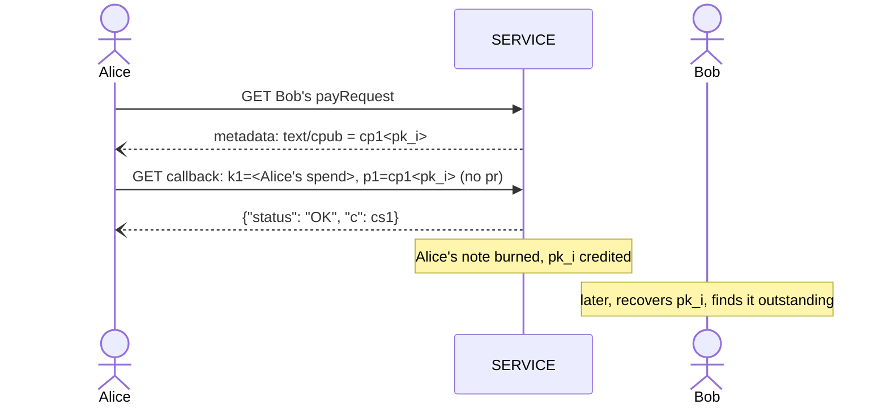

LUD-26: `LNURLcash` note derivation and Lightning Address.
====================================================

`author: dni` `co-authors: tbk (Thebora Kompanioni), thecryptodonkey` `status: draft`

---

This document extends [LUD-25](25.md) with deterministic key-path notes: derivation from a seed, recovery, watch-only export, and receiving notes through a Lightning Address. Terms such as `SERVICE`, `WALLET`, `Q`, `cp1`, `ck1`, rotate, split and merge are as defined in [LUD-25](25.md).

## Seed & derivation

`WALLET` SHOULD derive its key-path notes deterministically, using plain [BIP-32](https://github.com/bitcoin/bips/blob/master/bip-0032.mediawiki). Each `SERVICE` gets its own root `S`, found with the exact domain-hashing steps [LUD-05](05.md) defines for its `linkingKey` but under a separate purpose, so that the two never share key material:

```
cashHashingKey   = derive(masterKey, m/139'/0)                      // LUD-05's step 1, own purpose
domainMaterial   = hmacSha256(cashHashingKey, full SERVICE domain)   // LUD-05's steps 2-3, unchanged
(d1, d2, d3, d4) = first 16 bytes of domainMaterial as 4 uint32      // exactly as LUD-05
S                = m/139'/d1/d2/d3/d4
```

Below `S`, the first index says what a key is for, and the two subtrees never mix:

```
S/0'/i'      wallet:    note i, hardened; never exported
S/1'/n'      shareable: account n, exported as its cx1
S/1'/n'/i    shareable: note i of account n, derivable from the cx1 alone
```

Every note's private key `sk_i` is the BIP-32 private key at its path, and its `Q` is `x(sk_i·G)` ([LUD-25](25.md)): a [BIP-340](https://github.com/bitcoin/bips/blob/master/bip-0340.mediawiki) signer negates `sk_i` whenever `sk_i·G` has odd `y`.

* **Wallet**, `S/0'/i'`: every note `WALLET` itself mints, rotates into, splits into or merges into. Hardened all the way down, so no public key of this subtree can be derived from another, and a leaked `sk_i` exposes that one note only.
* **Shareable**, `S/1'/n'/i`: a note credited to account `n` by [Lightning Address auto-mint](#lightning-address-auto-mint) or an [internal transfer](#internal-transfer), whichever rail delivered it. Every account has its own [`cx1`](#watch-only-export), one per `username`, terminal or counterparty; `WALLET` numbers them `0, 1, ...` in the order it creates them. Accounts are hardened, so no account's keys, public or private, can be derived from another's.

`i` is a counter per subtree. On the wallet subtree, `WALLET` increments it once per key it derives there, a mint's key or a rotate/split/merge's replacement key alike. On a shareable account, `SERVICE` advances it as it [credits](#crediting) notes there, so `SERVICE`'s auto-mints and `WALLET`'s own notes can never collide.

### Recovery

To recover on a fresh install from seed alone, `WALLET` re-derives `pk_0, pk_1, ...` of the wallet subtree and of each shareable account, for each known `SERVICE`, and GETs the withdraw LNURL with `?p=cp1<pk_i>` ([LUD-25](25.md)), stopping after some gap limit of consecutive unknown indices, the same convention HD wallets use for address recovery; it may jump ahead and binary-search the boundary instead of walking it one by one. Shareable accounts are discovered the way [BIP-44](https://github.com/bitcoin/bips/blob/master/bip-0044.mediawiki#account-discovery) discovers accounts: `WALLET` scans `S/1'/n'` for `n = 0, 1, ...` and stops after some gap limit of consecutive accounts with no known note. An account that is registered but has not been paid yet holds nothing and so is not found this way; `WALLET` MAY find it by its `username`, matching the `cp1` that `username`'s [`text/cpub`](#internal-transfer) publishes against the first keys of its own shareable accounts. Since each key's key-path `ck1` is deterministic, the recovered notes are spendable immediately. `SERVICE` MAY rate-limit this scan, in-band as `{"status": "ERROR", "reason": "rate limited"}`, since [LUD-01](01.md) makes HTTP status codes meaningless here. `WALLET` MUST NOT count a rate-limit response towards the gap limit.

Recovery covers key-path notes only. A bearer note or a script-path note needs its preimage or script tree, which the seed does not determine; `WALLET` MUST back those up by other means, or rotate them into key-path notes.

### Watch-only export

Because a shareable account's notes are derived non-hardened, `WALLET` can hand out the account's extended public key as a `cx1` to a `SERVICE`, companion device, bookkeeping tool or point-of-sale terminal that should enumerate and watch notes without ever being able to spend them. Whoever holds it derives `Q_i` with ordinary BIP-32 public child derivation (`CKDpub`) at index `i`.

`WALLET` MUST only ever export a shareable account `S/1'/n'`, never a key of the wallet subtree, and SHOULD create a fresh account for every party it hands a `cx1` to, so that a compromised or misbehaving one only ever sees, and can only ever expose, its own account. A `cx1` is therefore only ever a view of what was received through one account, and since whoever holds it can watch that account, `WALLET` SHOULD rotate each note it finds on a shareable account into a wallet note as soon as it discovers it.

`cx1<...>` is [BIP-350](https://github.com/bitcoin/bips/blob/master/bip-0350.mediawiki) bech32m of `chaincode` (32 bytes) concatenated with `P` (33 bytes, compressed), in [BIP-32](https://github.com/bitcoin/bips/blob/master/bip-0032.mediawiki#serialization-format)'s order, 113 characters. `P` keeps its `y` parity so that `CKDpub` applies unchanged.

## Lightning Address auto-mint

`SERVICE` MAY be handed a `cx1` to act on, not just watch: once `WALLET` registers one against a chosen `username`, `SERVICE` publishes an ordinary Lightning Address ([LUD-16](16.md)) at `https://<domain>/.well-known/lnurlp/<username>` and mints automatically for every payment it receives there, deriving the next unused `pk_i` from it itself and crediting the note at it, exactly as if `WALLET` had supplied `comment = cp1<pk_i>`. `WALLET` discovers what arrived the same way it recovers any note, scanning that `cx1`'s account.

### Registration

`WALLET` registers at the very Lightning Address it is claiming, so `dni@mint.example` is all it needs to know:

```
GET    https://<domain>/.well-known/lnurlp/<username>    // {"status": "ERROR", "reason": "unknown user"} while free
POST   https://<domain>/.well-known/lnurlp/<username>    // register:   cx1=<cx1>&sig=<hex>
DELETE https://<domain>/.well-known/lnurlp/<username>    // unregister: sig=<hex>
```

Parameters are sent `application/x-www-form-urlencoded`, so a browser `WALLET`'s POST needs no CORS preflight; `SERVICE` MUST still answer the preflight a DELETE needs. Answers are `{"status": "OK"}` or `{"status": "ERROR", "reason": string}`, never an HTTP status code ([LUD-01](01.md)). GET stays the ordinary [LUD-16](16.md) Lightning Address once registered. `username` is case-insensitive: `WALLET` signs, and `SERVICE` verifies and stores, its lowercase form. `SERVICE` MAY refuse a `username` it reserves, and MAY accept extra fields of its own alongside `cx1`, such as an `npub` to serve the same `username` as a [NIP-05](https://github.com/nostr-protocol/nips/blob/master/05.md) identifier; those are not signed.

Registering, or later unregistering, a `username` against a `cx1` MUST always be proven, never merely asserted: a `cx1` is not a secret, so `SERVICE` MUST require a [BIP-340](https://github.com/bitcoin/bips/blob/master/bip-0340.mediawiki) Schnorr signature with the account's own key `p` (the private key at `S/1'/n'`) over `sha256("LNURLcash:register:" || domain || ":" || username)` (or `:unregister:`), `domain` being `SERVICE`'s own full domain name, and reject the request unless it verifies against `x(P)` of the `cx1` being registered, or for unregister, the one on file. Binding `domain` stops a proof captured by one `SERVICE` from being replayed against another.

A registration is never overwritten: `SERVICE` MUST reject a POST for a `username` that is already registered, or held for an unpaid address fee, with `{"status": "ERROR", "reason": "already registered"}`. Since only the registering `cx1`'s own key can sign a register, a proof cannot be replayed to point a `username` at any other `cx1`. To move a `username` to a new `cx1`, `WALLET` unregisters and registers again, and the `username` is free for anyone in between.

Since accounts cost `WALLET` nothing, `SERVICE` MAY charge an address fee per registered `username` against spam: instead of activating a valid registration, it answers `{"status": "OK", "pr": string}`, a BOLT-11 invoice for the fee, and MUST NOT publish the Lightning Address, auto-mint or answer [internal transfers](#internal-transfer) for that `username` until the invoice settles. Until then the `username` is held for that registration only, and is released again if the invoice expires unpaid. `WALLET` MAY pay it from any wallet, or melt a note it holds at the same `SERVICE` ([LUD-25](25.md)). The fee is charged per registration: unregistering costs nothing and refunds nothing, and registering again pays again.

`SERVICE` advertises the address fee the way [LUD-25](25.md) advertises its mint fees, with an `Address fee: <fee_msat>` in the `text/plain` `metadata` entry of its mint `payRequest`; [LUD-06](06.md) allows that entry only once, so it shares it with any `Mint fees`, separated by a space (e.g. `Mint fees: 1000,2000 Address fee: 21000`). Without it, registering is assumed free. The authoritative fee is the amount of the `pr` a registration is answered with, and `WALLET` SHOULD refuse to pay one that exceeds the advertised fee.

### Crediting

This is the one place `SERVICE` picks an index on its own. On a shareable account it is the only party that does: `WALLET` mints, rotates, splits and merges into its wallet subtree only, and MUST NOT name a shareable account's key as a resulting note itself. Before crediting an auto-mint at `pk_i`, `SERVICE` MUST still confirm it is neither outstanding nor previously burned, and skip to the next index otherwise, so that an account registered again after an unregister never reuses a key.

> [!WARNING]
> If a device holding some `sk_i` of an account is ever compromised by other means (malware, bad RNG, disk theft), every other note still on that account is compromised too, since its `cx1` is held by others, exactly as for any shared non-hardened xpub. Other accounts and the wallet subtree are unaffected, which is one more reason to sweep received notes into wallet notes promptly.

## Internal transfer

If a payee registered a `cx1`, `SERVICE` SHOULD publish a single key of it in their `payRequest` metadata, the same way [LUD-16](16.md) publishes `text/identifier`:

```
[
    "text/cpub", // this payLink's mint accepts internal transfers
    content // cp1<pk_i>, the payee's next unused key
]
```

`pk_i` is the key [Lightning Address auto-mint](#lightning-address-auto-mint) would credit next, on the same account: an internal transfer is just another rail into the payee's Lightning Address, so it lands where a real payment would have. `SERVICE` MUST NOT publish the `cx1` itself, so that a payer learns one key of the payee and nothing else of their account. `SERVICE` keeps publishing the same `pk_i` until it is credited, by either rail, and only then advances to the next unused index; fetching the `payRequest` never advances it, so nobody can push the payee past their recovery gap limit by fetching it repeatedly.

A `WALLET` already holding a note on that same `SERVICE` MAY skip Lightning entirely: issue an ordinary rotate, split or merge naming that `cp1` as `p1`/`p2`. If two payers race for the same key, the second gets `already in use` ([LUD-25](25.md)) and fetches the `payRequest` again for the next one. Normal split/merge fees still apply; a plain rotate is free.



## Test Vectors

[`26-vectors.json`](26-vectors.json) covers, for [BIP-32](https://github.com/bitcoin/bips/blob/master/bip-0032.mediawiki#test-vectors)'s test vector 1 and 2 seeds, each `SERVICE` root, wallet notes `S/0'/i'`, shareable accounts `S/1'/n'` with their `cx1` and notes, each note's path, `sk`, `Q` (of both `y` parities) and `cp1`, and a register/unregister proof.
