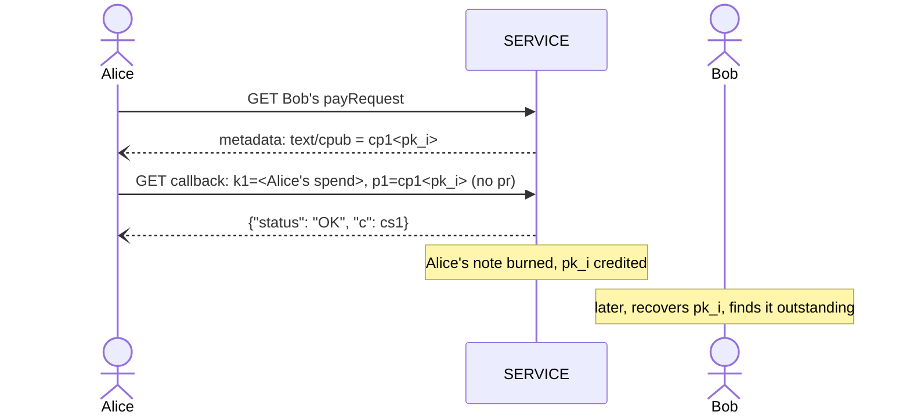

LUD-26: `LNURLcash` note derivation and Lightning Address.
====================================================

`author: dni` `co-authors: tbk (Thebora Kompanioni), thecryptodonkey` `status: draft`

---

This document extends [LUD-25](25.md) with deterministic key-path notes: derivation from a seed, recovery, watch-only export, and receiving notes through a Lightning Address. Terms such as `SERVICE`, `WALLET`, `Q`, `cp1`, `ck1`, rotate, split and merge are as defined in [LUD-25](25.md).

## Seed & derivation

`WALLET` SHOULD derive its key-path notes with [BIP-32](https://github.com/bitcoin/bips/blob/master/bip-0032.mediawiki). Each `SERVICE` gets its own root `S`, found with [LUD-05](05.md)'s domain-hashing steps under a purpose of its own, so that the two never share key material:

```
cashHashingKey   = derive(masterKey, m/139'/0)                      // LUD-05's step 1, own purpose
domainMaterial   = hmacSha256(cashHashingKey, full SERVICE domain)   // LUD-05's steps 2-3
(d1, d2, d3, d4) = first 16 bytes of domainMaterial as 4 uint32      // as LUD-05
S                = m/139'/d1/d2/d3/d4
```

Below `S`, keys follow [BIP-44](https://github.com/bitcoin/bips/blob/master/bip-0044.mediawiki)'s `account'/chain/index` layout, with a third chain for keys that may be shared:

```
S/a'/0/i       wallet:  every note WALLET mints, rotates or merges into, and a split's p1
S/a'/1/i       change:  a split's p2
S/a'/2/n'      share n, exported as its cx1
S/a'/2/n'/i    note i of share n, credited by SERVICE
```

A note's `sk_i` is the BIP-32 private key at its path, and its `Q` is `x(sk_i·G)` as in [LUD-25](25.md). An account `a` is an independent set of funds; most `WALLET`s only ever use account `0`. A share is made for one `username`, terminal or counterparty, numbered `0, 1, ...` in the order `WALLET` creates them.

Accounts and shares are hardened, so no account's or share's keys, public or private, can be derived from another's. Note indices are not hardened, as in BIP-44; since only a share's `cx1` is ever exported, a leaked `sk_i` exposes at most its own note, or its own share ([Watch-only export](#watch-only-export)).

`i` counts per chain and per share. `WALLET` advances the wallet and change counters once per key it derives there, a mint's key or a rotate/split/merge's replacement key alike. Only `SERVICE` picks indices on a share ([Crediting](#crediting)): `WALLET` MUST NOT name a share's key as a resulting note itself, so the two never collide.

### Recovery

To recover from seed alone, `WALLET` re-derives `pk_0, pk_1, ...` on each chain and each share of each known `SERVICE`, and GETs the withdraw LNURL with `?p=cp1<pk_i>` ([LUD-25](25.md)), stopping after some gap limit of consecutive unknown indices; it may binary-search the boundary instead of walking it. Accounts and shares are discovered like [BIP-44](https://github.com/bitcoin/bips/blob/master/bip-0044.mediawiki#account-discovery)'s accounts, `a = 0, 1, ...` and `n = 0, 1, ...`, stopping after some gap limit of consecutive ones with no known note. A share registered but not yet paid holds nothing; `WALLET` MAY find it by its `username`, matching that `username`'s [`text/cpub`](#internal-transfer) against the first keys of its own shares. Recovered notes are spendable immediately, since a key-path `ck1` is deterministic.

`SERVICE` MAY rate-limit this scan with `{"status": "ERROR", "reason": "rate limited"}` ([LUD-01](01.md)). `WALLET` MUST NOT count it towards the gap limit.

Bearer and script-path notes need their preimage or script tree, which the seed does not determine; `WALLET` MUST back those up by other means, or rotate them into key-path notes.

### Watch-only export

A share's [extended public key](https://github.com/bitcoin/bips/blob/master/bip-0032.mediawiki#extended-keys) (xpub), written `cx1`, lets a `SERVICE`, companion device, bookkeeping tool or point-of-sale terminal enumerate the share's notes with plain BIP-32 public derivation (`CKDpub`), without being able to spend them:

```
cx1 = bech32m("cx", chaincode (32 bytes) || P (33 bytes, compressed))   // BIP-32's order, 113 characters
```

using [BIP-350](https://github.com/bitcoin/bips/blob/master/bip-0350.mediawiki)'s bech32m. `WALLET` MUST NOT export any key but a share's `cx1`, and SHOULD use a fresh share for every party it hands one to, so that each party only ever sees what arrived through its own share. Since that party can watch the share, `WALLET` SHOULD rotate each note it finds there into a wallet note promptly.

> [!WARNING]
> As with any non-hardened xpub held by others, a leaked `sk_i` of a share, together with its `cx1`, exposes every other note still on that share. Other shares and the wallet and change chains are unaffected, which is one more reason to sweep received notes promptly.

## Lightning Address auto-mint

Once `WALLET` registers a `cx1` against a `username`, `SERVICE` publishes an ordinary [LUD-16](16.md) Lightning Address at `https://<domain>/.well-known/lnurlp/<username>` and mints automatically for every payment it receives there into the share's next unused `pk_i`, exactly as if `WALLET` had supplied `comment = cp1<pk_i>`. `WALLET` finds what arrived by scanning the share, as in recovery.

### Registration

`WALLET` registers at the very Lightning Address it is claiming, so `dni@mint.example` is all it needs to know:

```
GET    https://<domain>/.well-known/lnurlp/<username>    // {"status": "ERROR", "reason": "unknown user"} while free
POST   https://<domain>/.well-known/lnurlp/<username>    // register:   cx1=<cx1>&sig=<hex>
DELETE https://<domain>/.well-known/lnurlp/<username>    // unregister: sig=<hex>
```

Parameters are sent `application/x-www-form-urlencoded`, so a browser `WALLET`'s POST needs no CORS preflight; `SERVICE` MUST still answer the preflight a DELETE needs. Answers are `{"status": "OK"}` or `{"status": "ERROR", "reason": string}`, never an HTTP status code ([LUD-01](01.md)). Once registered, GET serves the ordinary [LUD-16](16.md) `payRequest`. `username` is case-insensitive and is signed and stored in lowercase. `SERVICE` MAY refuse a `username` it reserves, and MAY accept unsigned extra fields alongside `cx1`, such as an `npub` to serve the same `username` as a [NIP-05](https://github.com/nostr-protocol/nips/blob/master/05.md) identifier.

A `cx1` is not a secret, so `sig` proves ownership: a [BIP-340](https://github.com/bitcoin/bips/blob/master/bip-0340.mediawiki) signature by the share's own key `p` (the private key at `S/a'/2/n'`) over `sha256("LNURLcash:register:" || domain || ":" || username)` (or `:unregister:`), `domain` being `SERVICE`'s own full domain name. `SERVICE` MUST reject the request unless it verifies against `x(P)` of the `cx1` being registered, or for unregister, the one on file. Binding `domain` stops a proof captured by one `SERVICE` from being replayed against another.

A registration is never overwritten: `SERVICE` MUST reject a POST for a `username` that is already registered, or held for an unpaid address fee, with `{"status": "ERROR", "reason": "already registered"}`. To move a `username` to a new `cx1`, `WALLET` unregisters and registers again, and the `username` is free for anyone in between.

Since shares cost `WALLET` nothing, `SERVICE` MAY charge an address fee per registration against spam: it answers a valid registration with `{"status": "OK", "pr": string}`, a BOLT-11 invoice for the fee, and MUST NOT publish the Lightning Address, auto-mint or answer [internal transfers](#internal-transfer) for that `username` until it settles. Until then the `username` is held for that registration only, and released if the invoice expires unpaid. `WALLET` MAY pay it from any wallet, or melt a note it holds at the same `SERVICE` ([LUD-25](25.md)). Unregistering costs and refunds nothing; registering again pays again.

`SERVICE` advertises the fee as `Address fee: <fee_msat>` in the `text/plain` `metadata` entry of its mint `payRequest`, after any `Mint fees` ([LUD-25](25.md)) and separated by a space, since [LUD-06](06.md) allows that entry only once (e.g. `Mint fees: 1000,2000 Address fee: 21000`). Without it, registering is free. `WALLET` SHOULD refuse to pay a `pr` that exceeds the advertised fee.

### Crediting

Before crediting a payment at a share's `pk_i`, `SERVICE` MUST confirm that `pk_i` is neither outstanding nor previously burned, and skip to the next index otherwise, so that a share registered again after an unregister never reuses a key.

## Internal transfer

If a payee registered a `cx1`, `SERVICE` SHOULD publish a single key of it in their `payRequest` metadata, the same way [LUD-16](16.md) publishes `text/identifier`:

```
[
    "text/cpub", // this payLink's mint accepts internal transfers
    content // cp1<pk_i>, the payee's next unused key
]
```

`pk_i` is the key [auto-mint](#lightning-address-auto-mint) would credit next, so an internal transfer lands where a Lightning payment would have. `SERVICE` MUST NOT publish the `cx1` itself, so that a payer learns one key of the payee and nothing else. `SERVICE` keeps publishing the same `pk_i` until it is credited, by either rail; fetching the `payRequest` never advances it, so nobody can push the payee past their recovery gap limit.

A `WALLET` already holding a note on that same `SERVICE` MAY skip Lightning entirely: issue an ordinary rotate, split or merge naming that `cp1` as `p1`/`p2`. If two payers race for the same key, the second gets `already in use` ([LUD-25](25.md)) and fetches the `payRequest` again for the next one. Normal split/merge fees still apply; a plain rotate is free.



## Test Vectors

[`26-vectors.json`](26-vectors.json) covers both [BIP-32](https://github.com/bitcoin/bips/blob/master/bip-0032.mediawiki#test-vectors) test vector 1 and 2 seeds: `SERVICE` roots, wallet, change and share notes of accounts `0` and `1` with each note's path, `sk`, `Q` (of both `y` parities) and `cp1`, each share's `cx1`, and a register/unregister proof.
