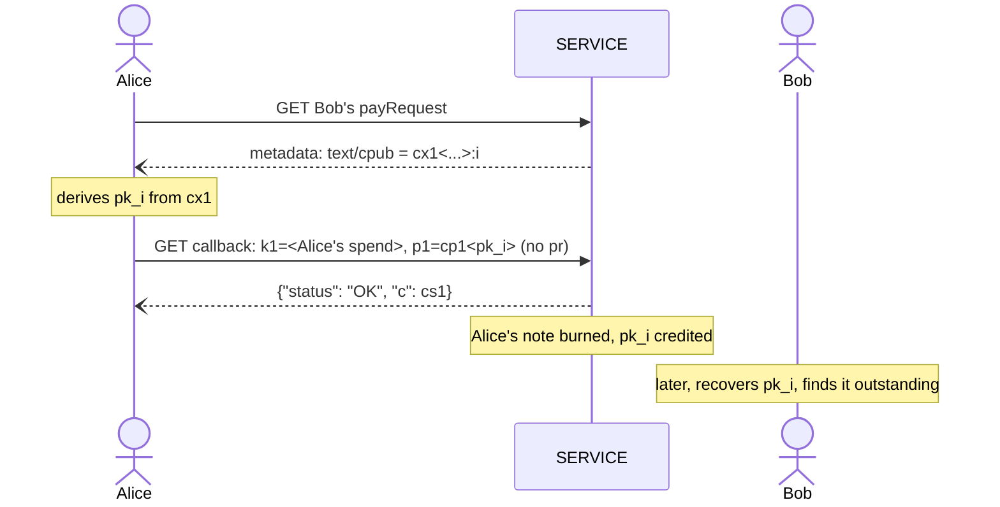

LUD-26: `LNURLcash` note derivation and Lightning Address.
====================================================

`author: dni` `co-authors: tbk (Thebora Kompanioni), thecryptodonkey` `status: draft`

---

This document extends [LUD-25](25.md) with deterministic key-path notes: derivation from a seed, recovery, watch-only export, and receiving notes through a Lightning Address. Terms such as `SERVICE`, `WALLET`, `Q`, `cp1`, `ck1`, rotate, split and merge are as defined in [LUD-25](25.md).

## Seed & derivation

`WALLET` SHOULD derive its key-path notes deterministically. The branch root for a given `SERVICE` is derived hardened, reusing the exact domain-hashing steps [LUD-05](05.md) already defines for its `linkingKey`, under a separate purpose so the two never share key material:

```
cashHashingKey   = derive(masterKey, m/139'/0)                      // LUD-05's step 1, own purpose
domainMaterial   = hmacSha256(cashHashingKey, full SERVICE domain)   // LUD-05's steps 2-3, unchanged
(d1, d2, d3, d4) = first 16 bytes of domainMaterial as 4 uint32      // exactly as LUD-05
p, chaincode     = derive(masterKey, m/139'/d1/d2/d3/d4)             // this SERVICE's branch root, hardened
P                = p·G
```

Individual note keys are then derived from that branch root *non-hardened*, with the same parity handling [BIP-341](https://github.com/bitcoin/bips/blob/master/bip-0341.mediawiki) uses to tweak an x-only key:

```
t     = tagged_hash("LNURLcash/derive", P || chaincode || ser32(purpose) || ser32(i))  (mod n)
Q_i   = lift_x(P) + t·G
pk_i  = x(Q_i)                        // the note's Q, computable from (P, chaincode) alone
sk_i  = p + t          (mod n)        if P has even y
sk_i  = (n - p) + t    (mod n)        otherwise
```

`purpose` splits a `SERVICE` branch into three independent counters, so that a `WALLET`'s own indices and a `SERVICE`'s auto-minted indices can never collide by coincidence, and each kind of note can be scanned for and restored on its own:

* `0`, wallet: every note `WALLET` itself mints, rotates into or merges into, and a split's resulting note `p1`.
* `1`, change: a split's change note `p2` — the same receive/change split an on-chain HD wallet already makes.
* `2`, Lightning Address: a note credited by [Lightning Address auto-mint](#lightning-address-auto-mint) or an [internal transfer](#internal-transfer), whichever rail delivered it.

`i` is a per-`purpose`, per-`SERVICE` counter `WALLET` increments once per key it derives on that purpose, a mint's key or a rotate/split/merge's replacement key alike.

### Recovery

To recover on a fresh install from seed alone, `WALLET` re-derives `pk_{purpose,0}, pk_{purpose,1}, ...` independently for each of the three purposes, for each known `SERVICE`, and GETs the withdraw LNURL with `?p=cp1<pk_i>` ([LUD-25](25.md)), stopping after some gap limit of consecutive unknown indices per purpose, the same convention HD wallets use for address recovery; it may jump ahead and binary-search the boundary instead of walking it one by one. Since each key's key-path `ck1` is deterministic, the recovered notes are spendable immediately. `SERVICE` MAY rate-limit this scan, in-band as `{"status": "ERROR", "reason": "rate limited"}`, since [LUD-01](01.md) makes HTTP status codes meaningless here. `WALLET` MUST NOT count a rate-limit response towards the gap limit.

Recovery covers key-path notes only. A bearer note or a script-path note needs its preimage or script tree, which the seed does not determine; `WALLET` MUST back those up by other means, or rotate them into key-path notes.

### Watch-only export

Because the index-level derivation is non-hardened, `WALLET` can hand out `cx1<P || chaincode>` for a `SERVICE`'s branch, an xpub for notes, to a companion device, bookkeeping tool or point-of-sale terminal that should enumerate and watch its notes without ever being able to spend them. One `cx1` covers all three purposes: a watcher scans each purpose's counter independently, exactly as `WALLET` itself does.

`cx1<...>` is [BIP-350](https://github.com/bitcoin/bips/blob/master/bip-0350.mediawiki) bech32m of `P` (32 bytes, x-only) concatenated with `chaincode` (32 bytes), 112 characters.

## Lightning Address auto-mint

`SERVICE` MAY be handed a `cx1` to act on, not just watch: once `WALLET` registers one against a chosen `username`, `SERVICE` publishes an ordinary Lightning Address ([LUD-16](16.md)) at `https://<domain>/.well-known/lnurlp/<username>` and mints automatically for every payment it receives there, deriving the next unused `pk_i` on purpose `2` itself and crediting the note at it, exactly as if `WALLET` had supplied `comment = cp1<pk_i>`. `WALLET` discovers what arrived the same way it recovers any note, scanning purpose `2`.

Registering, or later unregistering, a `username` against a `cx1` MUST always be proven, never merely asserted: `cx1` alone is public, so `SERVICE` MUST require a [BIP-340](https://github.com/bitcoin/bips/blob/master/bip-0340.mediawiki) Schnorr signature with the branch's purpose-`0` index-0 key `sk_0` over `sha256("LNURLcash:register:" || domain || ":" || username)` (or `:unregister:`), `domain` being `SERVICE`'s own full domain name, and reject the request unless it verifies against `pk_0`, which `SERVICE` derives from the `cx1` itself. Binding `domain` stops a proof captured by one `SERVICE` from being replayed against another. Registering a fresh `username` proves control of the new `cx1`; overwriting an already-registered one proves control of the branch currently on file, not of the new `cx1` being switched to.

This is the one place `SERVICE` picks an index on its own, and its "next unused" is only ever a guess: `WALLET` may have derived that same purpose-`2` `pk_i` for a mutation it hasn't submitted yet. Before crediting an auto-mint at `pk_i`, `SERVICE` MUST confirm it is neither outstanding nor previously burned, and skip to the next index otherwise. A mutation that later names an index `SERVICE` has meanwhile auto-minted into gets the `already in use` error ([LUD-25](25.md)), and `WALLET` retries at the next index.

> [!WARNING]
> If a device holding some `sk_i` on this branch is ever compromised by other means (malware, bad RNG, disk theft) while `cx1` for that branch is public, every other note on the branch is compromised too, exactly as for any shared non-hardened xpub.

## Internal transfer

If a payee registered a `cx1`, `SERVICE` SHOULD publish it in their `payRequest` metadata, the same way [LUD-16](16.md) publishes `text/identifier`, appended with `:<i>`, its best-known next-unused index for that branch:

```
[
    "text/cpub", // this payLink's mint accepts internal transfers
    content // the payee's cx1<...>:<i>
]
```

`i` here is the same purpose-`2` counter [Lightning Address auto-mint](#lightning-address-auto-mint) advances: an internal transfer is just another rail into the payee's Lightning Address, so it MUST land on the same branch a real payment would have, never on purpose `0`. A `WALLET` already holding a note on that same `SERVICE` MAY skip Lightning entirely: derive `pk_i` from `cx1` on purpose `2` starting at `i`, then issue an ordinary rotate, split or merge naming `cp1<pk_i>` as `p1`/`p2`. `i` is only a hint: on `already in use`, `WALLET` retries at the next index. Normal split/merge fees still apply; a plain rotate is free.



## Test Vectors

[`26-vectors.json`](26-vectors.json) covers branch derivation from [BIP-32](https://github.com/bitcoin/bips/blob/master/bip-0032.mediawiki#test-vectors)'s test vector 1 and 2 seeds, whose branch keys `P` have opposite `y` parity so both `sk_i` formulas are exercised, per-note `t`, `Q`, `sk` and `cp1` across purposes and indices, the `cx1` export, and a register/unregister proof. The first seed's purpose-`0` index-0 key is the one [LUD-25](25.md)'s key-path spend vector signs with.
